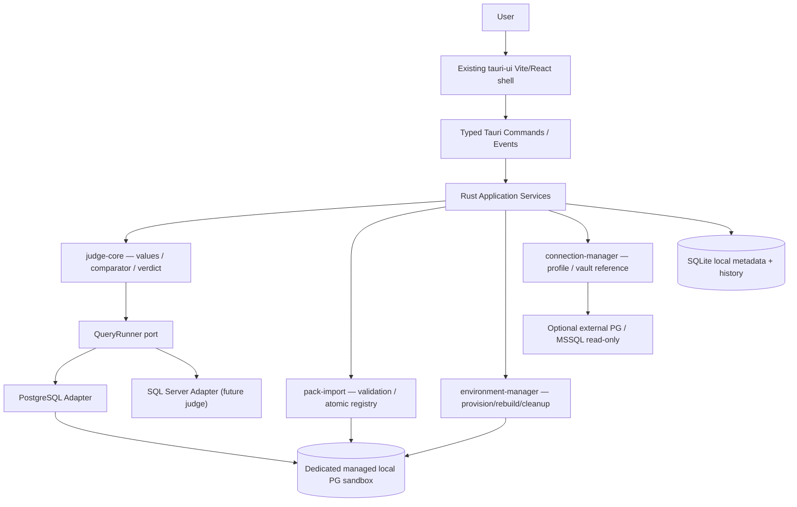

# Architecture — Offline-first SQL Judge

## Decision
Modular monolith inside existing Tauri 2 application. Rust `judge-core` independent of Tauri, SQL driver and persistence. Local SQLite stores product state. Managed PostgreSQL is a distinct process/server and **not** the SQLite app DB. External PostgreSQL / Microsoft SQL Server are optional read-only connections; their latency/offline state must not block local learning. Preserve existing Vite React/shadcn b0 code; introduce modules incrementally rather than reconstructing the starter.

## Context diagram


## Target source layout — adapt after inspecting actual scaffold
```
sql-judge/                        # CURRENT generated tauri-ui root; do not rename
├── src/                          # existing Vite/React frontend
│   ├── components/ui/            # generated shadcn; reuse existing patterns
│   ├── features/
│   │   ├── problems/             # list + details
│   │   ├── editor/               # Monaco + draft persistence
│   │   ├── submissions/          # results/diffs/history
│   │   ├── connections/          # profiles/connection tests
│   │   ├── environments/         # lifecycle + confirmation
│   │   └── packs/                # importer/validation feedback
│   └── lib/tauri-api.ts          # typed invoke wrappers (after contracts)
├── src-tauri/                    # existing create-tauri-ui native shell
│   ├── src/commands/             # thin handlers
│   └── tauri.conf.json           # preserve existing release/window config
├── crates/                       # ADD gradually using Cargo workspace layout
│   ├── judge-core/               # pure models, policy, comparator; no IO
│   ├── judge-postgres/           # PG execute / encoding / error map
│   ├── judge-sqlserver/          # MSSQL read-only first
│   ├── problem-pack/             # loader, manifest, import validator
│   ├── environment-manager/      # provision, markers, reset, cleanup
│   ├── connection-manager/       # profile, vault, role capabilities
│   └── app-storage/              # SQLite repository
├── docs/ schemas/ examples/ scripts/ tasks/
└── .github/workflows/           # PRESERVE generated workflow
```
`Cargo.toml` workspace at root is only introduced when needed; `src-tauri` must remain the Tauri entrypoint. Do not blindly introduce a JS monorepo or replace Bun lockfile.

## Crate ownership and dependencies
| Unit | Responsible for | Must NOT depend on |
|---|---|---|
| `judge-core` | QueryResult + SqlValue, column policy, verdict, multiset/ordered comparator, runner interface | Tauri, postgres, tiberius, sqlite, OS |
| `judge-postgres` | PG codec, runner, fixture setup adapter, timeout/cancel | React, app-storage |
| `judge-sqlserver` | T-SQL driver, capabilities, metadata, read-only browser; deferred sandboxed judge | React, PG-specific assumptions |
| `problem-pack` | v1 manifest, paths/hash, schema validation, import staging | Tauri, UI |
| `environment-manager` | owned resources, idempotent lifecycle, rollback/cleanup | React |
| `connection-manager` | profiles, per-driver TLS/policy, credential-vault references | judge-core implementation details |
| `app-storage` | SQLite migrations, history, cached metadata, progress queries | UI |
| `src-tauri` | compose dependencies, app state, command validation, event streaming | business rules implemented directly in commands |
| `src/features` | UI state, accessibility, display | DB drivers, secrets, admin SQL |

## Domain types (logical contract, NOT copy-paste compilable Rust)
- `PackId`, `ProblemId`, `ProblemVersion`, `FixtureId`, `SubmissionId`, `EnvironmentId`, `ConnectionId` as distinct validated identifiers.
- `Problem { pack_key, id, dialect, statement, reference, fixtures, output_policy, limits }`.
- `QueryResult { columns: Vec<Column {name,type_oid/logical_type}>, rows: Vec<Vec<SqlValue>> }`.
- `SqlValue { Null, Bool, Signed, Unsigned, Decimal(canonical), Float(bits + special), Text, Bytes, Date, Time, Timestamp, TzTimestamp, Uuid, JsonCanonical, Array }` — build type-by-type with explicit unsupported behavior.
- `Verdict { Accepted, WrongAnswer, SyntaxError, RuntimeError, TimeLimitExceeded, ResultLimitExceeded, PolicyViolation, Cancelled, JudgeError }`.
- `Environment { env_id, pack_id, version, engine, ownership_marker, db_instance_id, namespace, lifecycle_state }`.
- `ConnectionProfile { id, engine, endpoint, db_name, tls_mode, username, secret_ref, mode }` never contains plaintext credential.

## Execution workflows
### Submit
1. Tauri validates input size and problem/pack IDs; load immutable version/hash.
2. Judge validates one read query and selects *managed ephemeral* fixture target; command cannot receive admin connection string from frontend.
3. For each fixture, provision clean environment, apply trusted schema/fixture using provisioner, then disconnect admin access.
4. Run reference SQL then user SQL under identically constrained low-privilege query identities on equivalent initial data; collect typed bounded results.
5. Compare with configured comparator. Map *reference/setup failures* to `JudgeError`; user syntax/runtime/limit fail respectively; persist per-test traces and aggregate verdict.
6. Cleanup in finally/guard including timeouts/cancel/crash-recovery sweeper. Emit progress via Tauri events tied to `submission_id`.
7. Persist SQLite transaction and return typed DTO; never emit hidden fixture contents to ordinary problem UI.

### Import
Untrusted ZIP/dir -> staged extraction with limits -> manifest/version validation -> hash/collision check -> dialect/schema parse safety lint -> disposable local DB validation -> reference fixtures execution + optional metamorphic tests -> atomic content-addressed installation + SQLite commit; on any error rollback temp files/DB and emit structured report.

### Reset/Rebuild
Only application-owned environment with ownership proof; acquire env-wide lock; show impact summary; create replacement env *first*; validate schema/seed; atomically move active mapping; release old environment; cleanup async with durable recovery state. Never fall back to `DROP` on external profile.

## Consistency, concurrency and restart
- At most one active submit per managed environment for MVP; independent ephemeral fixture runs may be serialized.
- Stable submission ID and progress sequence counters; events may be dropped when window closes, so persisted status is source of truth.
- SQLite migrations idempotent; enable WAL when supported; never mix external DB credentials into SQLite.
- Track env transitions with `creating`, `ready`, `rebuilding`, `retired`, `error`; startup reaper enumerates only resources with valid ownership marker and durable ledger.
- Cancellation has two layers: driver query cancellation and watchdog/process containment. Cleanup happens even if UI dies.

## Interface direction
Frontend TypeScript `invoke<DTO>(command,{...})` -> Tauri command handler validates -> application service -> domain ports + adapters. No frontend-generated raw administrative SQL. Use official [Tauri commands/events](https://v2.tauri.app/develop/calling-rust/); check installed API version before typing wrappers.

## Important limitations
`SELECT` statements can call functions with side effects; parse checks/read-only transactions are not sufficient for arbitrary malicious SQL. A dedicated restricted PostgreSQL instance/process is the security boundary for untrusted SQL. External explorer must use read-only credentials and restrictive server-side limits. SQL Server's T-SQL parsing and permission model differ; separate implementation/tests required.
